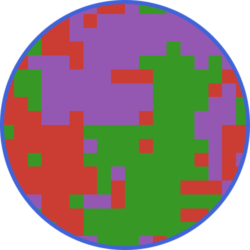
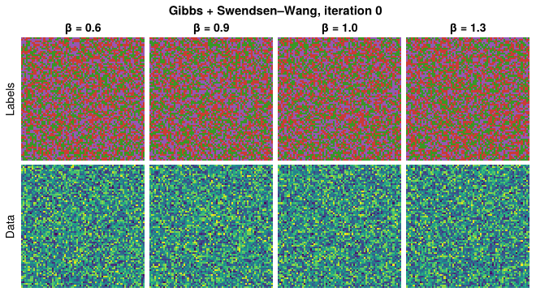

# HiddenMarkovRandomFields 

[![][docs-dev-img]][docs-dev-url]
[](https://github.com/msainsburydale/HiddenMarkovRandomFields.jl/actions/workflows/CI.yml)
[](https://app.codecov.io/gh/msainsburydale/HiddenMarkovRandomFields.jl)

[docs-dev-img]: https://img.shields.io/badge/docs-dev-blue.svg
[docs-dev-url]: https://msainsburydale.github.io/HiddenMarkovRandomFields.jl/dev/

`HiddenMarkovRandomFields` is a Julia package for **fast simulation of hidden Markov random fields** on regular grids. It currently implements the hidden Potts model: each pixel has an unobserved label, the labels follow a Potts model, and the observed value at a pixel is drawn from a distribution that depends on its label. The Potts model itself, in which the labels are observed directly, is also supported.

<p align="center">
  
</p>
<p align="center"><em>Gibbs and Swendsen–Wang sampling of a hidden Potts model with three labels, from random labels, for four values of β (the critical value is β ≈ 1.005).</em></p>

- **Unconditional simulation** of entire fields: labels and data.
- **Conditional simulation** of the missing values of incomplete data, given the observed values.
- **Any emission distributions** from [Distributions.jl](https://github.com/JuliaStats/Distributions.jl), one per label, including point masses (e.g., `Dirac(0.0)` for zero-inflated data).
- **Parameters per chain.** Each chain can have its own β and emission distributions, e.g. to simulate the training data of a neural estimator in one call.
- **Fast MCMC.** Each iteration is a chequerboard heat-bath Gibbs sweep, combined with Swendsen–Wang cluster updates that account for the data. The inner loops do not allocate.
- **Parallel and reproducible.** Independent chains run in parallel over threads, and a single chain can also use several threads (for grids of about 64 × 64 pixels or more). The results depend only on the random-number generator, not on the number of threads.
- **GPU sampling.** With a GPU package such as CUDA.jl loaded, `backend = CUDABackend()` runs all the chains together on the GPU, including the Swendsen–Wang updates and drawing the data, and returns the results on the GPU.

See the [documentation](https://msainsburydale.github.io/HiddenMarkovRandomFields.jl/dev/) for the model, the algorithms and examples.

### Installation

Please first install the current stable release of [Julia](https://julialang.org/downloads/). Then install the development version of the package using the following command inside Julia:

```julia
using Pkg; Pkg.add(url = "https://github.com/msainsburydale/HiddenMarkovRandomFields.jl")
```

### Quick start

```julia
using HiddenMarkovRandomFields, Distributions

# Inverse temperature and one emission distribution per label (q = 3 labels)
β = 1.0
distributions = [Normal(-1, 0.4), Normal(0, 0.4), Normal(1, 0.4)]

# Unconditional simulation on a 100 × 100 grid: labels Y and data Z
Y, Z = simulatehiddenpotts(100, 100, β, distributions)
z = Z[:, :, 1, 1]

# Remove 20% of the data, then simulate the missing values with 30 independent chains
Z₁ = Matrix{Union{Missing, Float64}}(z)
Z₁[rand(size(z)...) .< 0.2] .= missing
Y, Z = simulatehiddenpotts(Z₁, β, distributions; nchains = 30)

# The Potts model itself: unconditional and conditional simulation of the labels
Y = simulatepotts(100, 100, 3, β)
Y₁ = Matrix{Union{Missing, Int}}(Y[:, :, 1, 1])
Y₁[1:50, 1:50] .= missing
Y = simulatepotts(Y₁, 3, β; nchains = 30)
```

Both functions return arrays of dimension `nrow × ncol × length(save_at) × nchains`. These hold the states of `nchains` independent chains after the iterations in `save_at`, which by default is the final iteration only. Start Julia with several threads (e.g., `julia --threads=auto`) to run the chains in parallel.

### Performance

The table gives the wall time (ms) of one iteration of one chain, on 1 thread / 32 threads / a GPU (the fastest in bold), for conditional simulation of a hidden Potts model with three labels at β = 1.0. It was measured on an AMD Threadripper PRO 5995WX and an NVIDIA RTX A4500, with Julia 1.12. "SW" denotes Swendsen–Wang updates, the default.

| Grid | Gibbs only | Gibbs + SW |
|:--|--:|--:|
| 64 × 64 | 0.019 / 0.0084 / **0.0039** | 0.096 / 0.057 / **0.026** |
| 256 × 256 | 0.29 / 0.033 / **0.0055** | 1.5 / 0.40 / **0.034** |
| 1024 × 1024 | 4.7 / 0.33 / **0.042** | 33 / 4.1 / **0.48** |

A single chain uses several threads by splitting the grid into blocks of columns, from about 64 × 64 pixels upwards. With several chains, the threads are shared among the chains: for grids up to 128 × 128 pixels, 30 chains on 32 threads take only slightly longer than one chain on one thread. On the GPU, all the chains run together: for example, an iteration of 1024 chains of 64 × 64 pixels takes 1.0 ms with Swendsen–Wang updates (3.4× faster than on 32 threads), and 0.063 ms with Gibbs sweeps only (11× faster). A batch of training data, 1024 fields of 64 × 64 pixels each with its own β and emission distributions, takes 0.18 s to simulate on the GPU with 200 iterations, against 0.62 s on 32 threads. See the [documentation](https://msainsburydale.github.io/HiddenMarkovRandomFields.jl/dev/performance) for more grid sizes and numbers of chains, unconditional simulation, parameters per chain, and how to reproduce the timings.

### Contributing

We welcome contributions of all sizes. To get started, see [CONTRIBUTING.md](CONTRIBUTING.md) for an overview of the code structure and the development workflow. A list of planned improvements is in [TODO.md](TODO.md), and instructions for contributing to the documentation are in [docs/README.md](docs/README.md).

If you encounter a bug or have a suggestion, please [open an issue](https://github.com/msainsburydale/HiddenMarkovRandomFields.jl/issues) or submit a pull request.

### Supporting and citing

This software was developed as part of academic research. If you would like to support it, please star the repository. If you use it in your research or other activities, please also use the following citation.

```bibtex
@misc{HiddenMarkovRandomFields,
  title = {{HiddenMarkovRandomFields.jl}: Fast simulation of hidden {M}arkov random fields in {J}ulia},
  author = {Sainsbury-Dale, Matthew},
  year = {2026},
  howpublished = {\url{https://github.com/msainsburydale/HiddenMarkovRandomFields.jl}}
}
```
