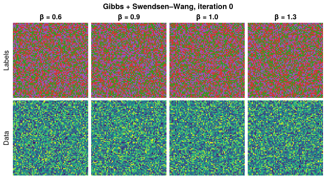

```@raw html
---
# https://vitepress.dev/reference/default-theme-home-page
layout: home

hero:
  name: HiddenMarkovRandomFields.jl
  text: Fast simulation of hidden Markov random fields
  tagline: Conditional and unconditional simulation of the hidden Potts model, and of the Potts model itself
  image:
    src: /logo.svg
    alt: HiddenMarkovRandomFields.jl
  actions:
    - theme: brand
      text: Examples
      link: /examples
    - theme: alt
      text: API
      link: /API

features:
  - icon: 🧩
    title: Any emission distributions
    details: Each label can have any univariate distribution from Distributions.jl, including point masses, which fix the labels of the pixels whose values equal their atoms.
    link: /model

  - icon: 🎯
    title: Conditional and unconditional
    details: Simulate the missing values of incomplete data given the observed values, or simulate entire fields.
    link: /examples

  - icon: 🎛️
    title: Parameters per chain
    details: Each chain can have its own β and emission distributions, so one call can simulate a whole batch of training data, e.g. for a neural estimator.
    link: /examples#Unconditional-simulation

  - icon: ⚡
    title: Gibbs and Swendsen–Wang
    details: Chequerboard heat-bath Gibbs sweeps combined with Swendsen–Wang cluster updates that account for the data, with allocation-free inner loops.
    link: /model

  - icon: 🔁
    title: Parallel and reproducible
    details: Independent chains run in parallel over threads, and a single chain can also use several threads (for grids of about 64 × 64 pixels or more). The results depend only on the random-number generator, not on the number of threads.
    link: /performance

  - icon: 🚀
    title: GPU sampling
    details: With a GPU package such as CUDA.jl, all the chains run together on the GPU, including the Swendsen–Wang updates and drawing the data, and the results stay on the GPU.
    link: /model#GPU-sampling
---
```

## Introduction

HiddenMarkovRandomFields.jl simulates hidden Markov random fields on regular grids. Each pixel has an unobserved label, and the labels follow a Markov random field. The observed value at a pixel is drawn from a distribution that depends on its label. The package currently implements the hidden Potts model and the Potts model; see [Model and algorithms](@ref).



*Gibbs and Swendsen–Wang sampling of a hidden Potts model with three labels, from random labels, for four values of β (the critical value is β ≈ 1.005).*

The package supports two kinds of simulation:

- **Unconditional simulation** of entire fields, of labels and data together. Typical uses are generating training data or studying the model. Each chain can have its own parameters, so one call can simulate a whole batch of training data.
- **Conditional simulation** of the missing values of incomplete data given the observed values. Typical uses are imputation, and the E-step of Monte Carlo EM algorithms ([Wei and Tanner, 1990](https://doi.org/10.1080/01621459.1990.10474930)), including the neural EM algorithm ([Sainsbury-Dale et al., 2025](https://arxiv.org/abs/2501.04330)).

The Potts model, in which the labels are observed directly, is supported by the same sampler.

## Installation

To install the package, first install the current stable release of [Julia](https://julialang.org/downloads/). Then install the development version of the package with the following command inside Julia:

```julia
using Pkg; Pkg.add(url = "https://github.com/msainsburydale/HiddenMarkovRandomFields.jl")
```

## Quick start

```julia
using HiddenMarkovRandomFields, Distributions

# Inverse temperature and one emission distribution per label (q = 3 labels)
β = 1.0
distributions = [Normal(-1, 0.4), Normal(0, 0.4), Normal(1, 0.4)]

# Unconditional simulation on a 100 × 100 grid: labels Y and data Z
Y, Z = simulatehiddenpotts(100, 100, β, distributions)
z = Z[:, :, 1, 1]

# Remove 20% of the data, then simulate the missing values with 30 independent chains
Z₁ = Matrix{Union{Missing, Float64}}(z)
Z₁[rand(size(z)...) .< 0.2] .= missing
Y, Z = simulatehiddenpotts(Z₁, β, distributions; nchains = 30)

# The Potts model itself: unconditional and conditional simulation of the labels
Y = simulatepotts(100, 100, 3, β)
Y₁ = Matrix{Union{Missing, Int}}(Y[:, :, 1, 1])
Y₁[1:50, 1:50] .= missing
Y = simulatepotts(Y₁, 3, β; nchains = 30)
```

Both functions return arrays of dimension `nrow × ncol × length(save_at) × nchains`. These hold the states of `nchains` independent chains after the iterations in `save_at`, which by default is the final iteration only. Start Julia with several threads (e.g., `julia --threads=auto`) to run the chains in parallel.

## Contributing

We welcome contributions of all sizes. To get started, see [CONTRIBUTING.md](https://github.com/msainsburydale/HiddenMarkovRandomFields.jl/blob/main/CONTRIBUTING.md). If you encounter a bug or have a suggestion, please [open an issue](https://github.com/msainsburydale/HiddenMarkovRandomFields.jl/issues) or submit a pull request.
